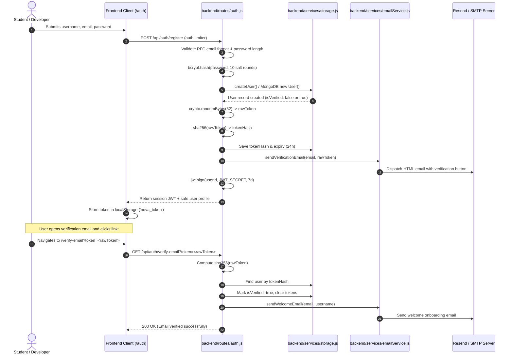
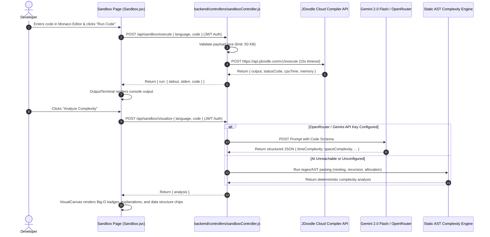
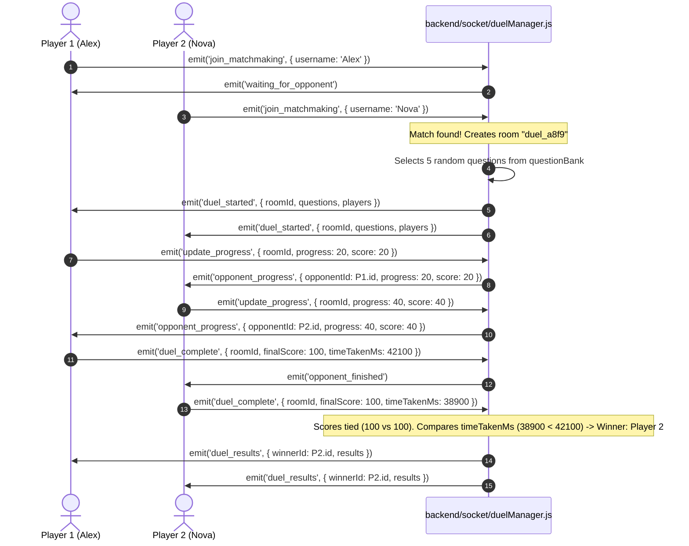
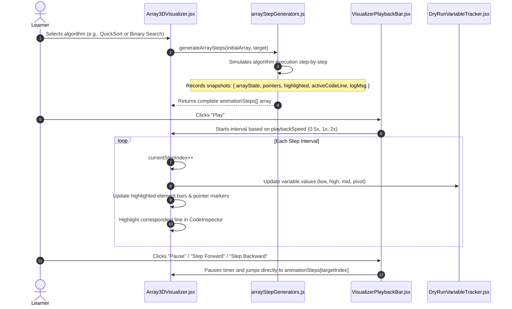

# Algoverse (Code Nova) — Comprehensive Architecture & Technical Documentation

---

## 1. Executive Overview & System Topology

**Algoverse** (also known as **Code Nova**) is a full-stack, browser-based computer science education, visualization, and competitive programming platform. It combines:
1. **Interactive Visualizers**: 3D and 2D animated visualizations for **Data Structures** (40+ algorithms), **Object-Oriented Programming** (4 pillars & inheritance variants), and **Cryptography** (13 classical, modern, and cryptanalytic ciphers).
2. **Code Studio & Sandbox**: An in-browser multi-language Monaco code editor executing in isolated containers via JDoodle, paired with a multi-tier AI complexity analysis engine (Google Gemini 2.0 Flash, OpenRouter, and a deterministic AST parser).
3. **Assessment & Gamification Engine**: 6 subject tracks, customizable level progression, daily streak tracking, activity heatmaps, and automated badge rewards sent via real emails.
4. **Multiplayer 1v1 PvP Coding Duels**: Real-time WebSockets ([Socket.io](file:///d:/yusra/programming/Major_Projects/Algoverse/backend/socket/duelManager.js)) matchmaking, question broadcasting, live opponent progress sync, and millisecond tie-breaker resolution.
5. **Host & Competition Center**: Teacher/host dashboards for hosting custom coding contests, generating automatic test cases, and viewing live leaderboards.

### 1.1 High-Level Architecture Diagram

```mermaid
graph TD
    Client["Frontend Client (React 19 + Vite + TailwindCSS v4)"]
    ThreeJS["Three.js / @react-three/fiber (3D Particle Field & 3D Library Room)"]
    Monaco["Monaco Code Editor & Visualizer Canvas"]
    SocketClient["Socket.io Client (Real-time PvP Duels)"]
    ZustandStore["Zustand Store (useAppStore) + AuthContext"]

    Client --> ThreeJS
    Client --> Monaco
    Client --> SocketClient
    Client --> ZustandStore

    Express["Backend API Server (Express 5.2 / Node.js)"]
    SocketServer["Socket.io Server (duelManager)"]

    Client -- "REST API (JWT Bearer)" --> Express
    SocketClient <== "WebSockets (Bi-directional)" ==> SocketServer

    subgraph Backend Services
        AuthService["Auth & Security (Bcrypt + Crypto)"]
        SandboxController["Sandbox Controller (JDoodle + LLM / AST)"]
        LevelEngine["Level Engine (OpenTDB Trivia + Curated Sets)"]
        EmailService["Email Engine (Resend API + Nodemailer SMTP)"]
        CompService["Competition & Leaderboard Engine"]
    end

    Express --> AuthService
    Express --> SandboxController
    Express --> LevelEngine
    Express --> EmailService
    Express --> CompService

    subgraph Persistence Layer (Dual-Resilient Engine)
        MongoAtlas[("MongoDB Atlas Primary")]
        LocalJSON[("Local Persistent JSON Storage (.data/*.json)")]
    end

    Express -- "Primary Connection (4s Timeout)" --> MongoAtlas
    Express -- "Automatic Zero-Downtime Fallback" --> LocalJSON

    subgraph External Cloud APIs
        JDoodleAPI["JDoodle Compiler API (Isolated Runtime)"]
        GeminiAPI["Google Gemini 2.0 Flash / OpenRouter LLM"]
        ResendAPI["Resend Email API / SMTP Host"]
        OpenTDBAPI["Open Trivia Database API"]
    end

    SandboxController --> JDoodleAPI
    SandboxController --> GeminiAPI
    EmailService --> ResendAPI
    LevelEngine --> OpenTDBAPI
```

---

## 2. Technology Stack Breakdown

| Layer | Technologies & Libraries | Key Responsibilities |
| :--- | :--- | :--- |
| **Frontend Framework** | [React 19](file:///d:/yusra/programming/Major_Projects/Algoverse/frontend/package.json#L28), [Vite 8](file:///d:/yusra/programming/Major_Projects/Algoverse/frontend/package.json#L45) | Component rendering, fast HMR bundling, code splitting. |
| **Styling & Motion** | [TailwindCSS v4](file:///d:/yusra/programming/Major_Projects/Algoverse/frontend/package.json#L32), [Framer Motion](file:///d:/yusra/programming/Major_Projects/Algoverse/frontend/package.json#L22), [GSAP](file:///d:/yusra/programming/Major_Projects/Algoverse/frontend/package.json#L23), [Lenis](file:///d:/yusra/programming/Major_Projects/Algoverse/frontend/package.json#L24) | Responsive UI, fluid layout transitions, smooth inertial scrolling. |
| **3D Graphics & Postprocessing** | [Three.js](file:///d:/yusra/programming/Major_Projects/Algoverse/frontend/package.json#L33), [@react-three/fiber](file:///d:/yusra/programming/Major_Projects/Algoverse/frontend/package.json#L15), [@react-three/drei](file:///d:/yusra/programming/Major_Projects/Algoverse/frontend/package.json#L14), [@react-three/postprocessing](file:///d:/yusra/programming/Major_Projects/Algoverse/frontend/package.json#L16) | 18,000 GPU GLSL morphing particle field on intro page, 3D interactive library room with procedural books and shelves. |
| **Code Editor** | [@monaco-editor/react](file:///d:/yusra/programming/Major_Projects/Algoverse/frontend/package.json#L13) | Multi-language syntax highlighting, line tracking, in-editor debugging. |
| **State & Navigation** | [Zustand](file:///d:/yusra/programming/Major_Projects/Algoverse/frontend/package.json#L34), [React Router v7](file:///d:/yusra/programming/Major_Projects/Algoverse/frontend/package.json#L30) | Global theme, XP, unlocked levels, authenticated routing guards. |
| **Backend Runtime** | [Express 5](file:///d:/yusra/programming/Major_Projects/Algoverse/backend/package.json#L21), Node.js (CommonJS) | REST routing, CORS policies, payload validation, error sanitization. |
| **Real-time Networking** | [Socket.io](file:///d:/yusra/programming/Major_Projects/Algoverse/backend/package.json#L27) | Matchmaking queues, 1v1 duel rooms, real-time score/progress broadcasting. |
| **Database & Fallback** | [Mongoose 9](file:///d:/yusra/programming/Major_Projects/Algoverse/backend/package.json#L24), FileSystem JSON ([storage.js](file:///d:/yusra/programming/Major_Projects/Algoverse/backend/services/storage.js)) | MongoDB Atlas with automatic fallback to local JSON database (`.data/`). |
| **AI & LLM Services** | [@google/genai](file:///d:/yusra/programming/Major_Projects/Algoverse/backend/package.json#L15) (Gemini 2.0 Flash), OpenRouter API | Code complexity reasoning, visual timeline generation, contextual hints. |
| **Code Execution Engine** | JDoodle Compiler REST API | Multi-language compilation (Node.js, Python 3, C++17, Java 4). |
| **Email Infrastructure** | [Resend SDK](file:///d:/yusra/programming/Major_Projects/Algoverse/backend/package.json#L26), [Nodemailer](file:///d:/yusra/programming/Major_Projects/Algoverse/backend/package.json#L25) | Transactional verification links, welcome emails, and badge announcements. |
| **Security & Cryptography** | [bcryptjs](file:///d:/yusra/programming/Major_Projects/Algoverse/backend/package.json#L18), [jsonwebtoken](file:///d:/yusra/programming/Major_Projects/Algoverse/backend/package.json#L23), [express-rate-limit](file:///d:/yusra/programming/Major_Projects/Algoverse/backend/package.json#L22), Node `crypto` | Password hashing (10 salt rounds), JWT revocation, SHA-256 token hashing, DDoS rate limiting. |

---

## 3. Data Models & Schema Definitions

All primary data entities are defined via Mongoose schemas under [`backend/models/`](file:///d:/yusra/programming/Major_Projects/Algoverse/backend/models) and mirrored in local persistent storage by [`backend/services/storage.js`](file:///d:/yusra/programming/Major_Projects/Algoverse/backend/services/storage.js).

### 3.1 User Model ([`backend/models/User.js`](file:///d:/yusra/programming/Major_Projects/Algoverse/backend/models/User.js))
Represents a registered platform account, credentials, verification state, and gamified progress.

```javascript
{
  username: { type: String, required: true, unique: true, trim: true },
  email: { type: String, required: true, unique: true, lowercase: true, trim: true },
  passwordHash: { type: String, required: true },

  // Verification & Security
  isVerified: { type: Boolean, default: true },
  verificationTokenHash: { type: String, default: null },
  verificationTokenExpiry: { type: Date, default: null },

  // Gamification & Retention
  activityLog: [{ type: String }],         // Array of date strings: "YYYY-MM-DD"
  currentStreak: { type: Number, default: 0 },
  longestStreak: { type: Number, default: 0 },
  earnedBadges: [{ 
    badgeId: String, 
    name: String, 
    awardedAt: { type: Date, default: Date.now } 
  }],
  xp: { type: Number, default: 0 }
}
```
* **Security Transform**: The schema defines a `toJSON` transform that strips `passwordHash`, `verificationTokenHash`, and `verificationTokenExpiry` before returning any JSON response.

### 3.2 Progress Model ([`backend/models/Progress.js`](file:///d:/yusra/programming/Major_Projects/Algoverse/backend/models/Progress.js))
Tracks the user's quest-world progression across the 3D learning world:
- `userId`: Reference to `User` document.
- `town1Unlocked`: Boolean (defaults to `true`).
- `town2Unlocked`: Boolean (unlocked after mastering fundamental arrays and stacks).
- `town3Unlocked`: Boolean (unlocked after advanced graph and dynamic programming challenges).
- `totalScore`: Cumulative assessment and quest score.

### 3.3 Competition Model ([`backend/models/Competition.js`](file:///d:/yusra/programming/Major_Projects/Algoverse/backend/models/Competition.js))
Represents coding competitions, either pre-seeded global challenges or custom contests created by instructors:
- `title`: Name of the competition.
- `hostOrg`: Host organization or username of the contest author.
- `startTime` / `endTime`: Contest active window.
- `status`: `'Upcoming'`, `'Active'`, or `'Completed'`.
- `type`: `'Global'`, `'Challenge'`, `'Series'`, or `'Hosted'`.
- `enrollmentCount`: Number of enrolled competitors.
- `questions`: Array of challenge problems containing `title`, `description`, `initialCode`, and `testCases` (`input`, `expectedOutput`).
- `participants`: Array of participant results containing `username`, `score`, `submissionTime`, and `timeTakenMs` (used as an exact millisecond tie-breaker).

### 3.4 Snippet Model ([`backend/models/Snippet.js`](file:///d:/yusra/programming/Major_Projects/Algoverse/backend/models/Snippet.js))
Stores user-saved sandbox code snippets:
- `userId`: Reference to `User`.
- `title`: Snippet label.
- `code`: Raw source code string.
- `language`: `javascript`, `python`, `cpp`, or `java`.
- `isPublic`: Visibility toggle.

---

## 4. Backend Services & Controller Architecture

### 4.1 Resilient Storage Fallback ([`backend/services/storage.js`](file:///d:/yusra/programming/Major_Projects/Algoverse/backend/services/storage.js))
Algoverse features an active-standby database design. When [`backend/server.js`](file:///d:/yusra/programming/Major_Projects/Algoverse/backend/server.js#L44-L56) attempts to connect to MongoDB Atlas, it enforces a 4-second timeout (`serverSelectionTimeoutMS: 4000`). If Atlas is unreachable or offline, the platform transparently switches to the resilient file-based storage engine in `.data/`:
- `readJson(filePath, defaultValue)` & `writeJson(filePath, data)`: Synchronous atomic reads and writes.
- `storage.findUserByEmail(email)`: Case-insensitive email lookup.
- `storage.findUserByUsername(username)`: Case-insensitive username lookup.
- `storage.createUser({ username, email, passwordHash })`: Handles unique duplicate checking and initializes user state.
- `storage.recordActivity(username)`: Checks today's date (`YYYY-MM-DD`). If the user logged activity yesterday, `currentStreak` increments; otherwise it resets to 1. Updates `longestStreak` if broken.
- `storage.awardBadge(username, badgeId, badgeName)`: Awards badges without duplicate assignment.

### 4.2 Email Notification Service ([`backend/services/emailService.js`](file:///d:/yusra/programming/Major_Projects/Algoverse/backend/services/emailService.js))
Handles outgoing transactional emails using a tiered delivery strategy:
1. **Resend API**: Invoked if `RESEND_API_KEY` is present.
2. **Nodemailer SMTP Transporter**: Invoked if `SMTP_HOST`, `SMTP_USER`, and `SMTP_PASS` are present.
3. **Simulated Delivery**: If neither provider is configured, it logs formatted notification logs to stdout for testing.

The service provides three core email templates with a dark glassmorphic HTML aesthetic:
- `sendVerificationEmail({ to, username, verificationLink })`: Dispatches an activation button with an expiring verification link.
- `sendWelcomeEmail({ to, username })`: Welcome message introducing the 3D Library, Visualizers, and PvP Duels.
- `sendBadgeEarnedEmail({ to, username, badgeName, badgeDescription })`: Gamification milestone notification congratulating the user on earning a new badge.

### 4.3 Sandbox Controller ([`backend/controllers/sandboxController.js`](file:///d:/yusra/programming/Major_Projects/Algoverse/backend/controllers/sandboxController.js))
Responsible for code compilation and deep algorithmic complexity analysis:

1. **`executeCode(req, res)`**:
   - Validates code length (maximum 50 KB to mitigate DoS payloads).
   - Maps standard language keys to JDoodle compiler identifiers:
     * `javascript` $\rightarrow$ `nodejs` (v4)
     * `python` $\rightarrow$ `python3` (v4)
     * `cpp` $\rightarrow$ `cpp17` (v0)
     * `java` $\rightarrow$ `java` (v4)
   - Executes with a strict 15-second timeout against JDoodle's execution endpoint.
   - Returns `{ run: { stdout, stderr, code } }`.

2. **`visualizeCode(req, res)`**:
   - Executes a multi-tier analysis pipeline:
     1. **OpenRouter API**: Tries models such as `openrouter/free`, `google/gemma-4-31b-it:free`, and `qwen/qwen3.8-27b:free`.
     2. **Google Gemini Native API**: If configured with `GEMINI_API_KEY`, calls `gemini-2.0-flash:generateContent`.
     3. **Deterministic Static Analyzer (`generateStaticAnalysis`)**: If external APIs fail or are offline, an AST-like pattern analyzer performs static regex analysis on the code:
        - Detects data structures: Arrays, Hash Maps, Sets, Stacks, Queues, Linked Lists, Binary Trees, Two Pointers.
        - Analyzes loop nesting depths ($O(1)$, $O(N)$, $O(N^2)$, $O(N^k)$).
        - Detects logarithmic step division (`/= 2`, `mid = (low + high) / 2` $\rightarrow$ $O(\log N)$).
        - Detects recursion and recursion + logarithmic divide-and-conquer ($O(N \log N)$).
        - Computes Space Complexity based on dynamic allocations (`new Array`, `vector`, recursion stack frames).

### 4.4 PvP Duel Manager ([`backend/socket/duelManager.js`](file:///d:/yusra/programming/Major_Projects/Algoverse/backend/socket/duelManager.js))
Manages real-time WebSockets communication for multiplayer coding battles:
- **`join_matchmaking`**: Queues incoming players. If a player is already waiting, matches them into a newly generated isolated room `duel_<randomBytes>`.
- **Question Selection**: Randomly picks 5 algorithmic and system design questions from an internal 20-question bank across Data Structures, OOP, Cryptography, and OS/Networking.
- **`update_progress`**: Broadcasts `opponent_progress` events whenever a player answers a question.
- **`duel_complete`**: Receives completion score and `timeTakenMs`. Once both players finish, calculates the winner (higher score wins; exact millisecond duration acts as the tie-breaker).
- **`disconnect`**: Automatically awards victory by default if an opponent disconnects during an active duel.

---

## 5. Frontend Architecture & State Management

### 5.1 Zustand App Store ([`frontend/src/store/useAppStore.js`](file:///d:/yusra/programming/Major_Projects/Algoverse/frontend/src/store/useAppStore.js))
Provides centralized client-side state across visualizers, sandbox, and gameplay:
- `user` / `token`: Cached in `localStorage` under keys `nova_user` and `nova_token`.
- `theme`: Multi-theme engine supporting `'light'`, `'warm'` (sepia/editorial aesthetic), and `'dark'` (cyberpunk aesthetic). Automatically applies `.dark` and `.warm` classes to `document.documentElement`.
- `currentCodeOutput`: Global execution output from the sandbox terminal.
- `totalXP`: Current player XP points accumulated from quizzes, duels, and visualizer modules.
- `unlockedLevels`: Map tracking unlocked stages per subject (`{ ds: 1, algo: 1, oop: 1 }`).
- Actions: `login()`, `logout()`, `setUser()`, `setTheme()`, `toggleTheme()`, `addXP()`, `unlockNextLevel()`.

### 5.2 Authentication Context & Navigation Guard ([`frontend/src/context/AuthContext.jsx`](file:///d:/yusra/programming/Major_Projects/Algoverse/frontend/src/context/AuthContext.jsx))
- **Session Validation**: On initial load, if a token exists in `localStorage`, the provider performs a silent handshake against `/api/auth/me`. If rejected (expired or revoked), the session is cleanly cleared.
- **`requireAuth(actionCallback, options)`**: Centralized access guard. If the user is authenticated, it executes `actionCallback()`. If unauthenticated, it redirects the user to `/auth` with a friendly return URL and explanatory flash message.
- **`ProtectedRoute`**: Component wrapper used in [`App.jsx`](file:///d:/yusra/programming/Major_Projects/Algoverse/frontend/src/App.jsx#L176) to protect platform routes (`/visualizer`, `/oop`, `/sandbox`, `/game`, `/host`).

### 5.3 Global Axios Token Interceptor ([`frontend/src/lib/api.js`](file:///d:/yusra/programming/Major_Projects/Algoverse/frontend/src/lib/api.js))
Automatically attaches the JWT Bearer token to all outgoing HTTP requests:
```javascript
axios.interceptors.request.use((config) => {
  const token = getAuthToken();
  if (token && (!config.headers || !config.headers.Authorization)) {
    config.headers = config.headers || {};
    config.headers.Authorization = `Bearer ${token}`;
  }
  return config;
});
```

---

## 6. Interactive Visualizers & Feature Deep-Dive

### 6.1 3D Particle Morphing Intro ([`frontend/src/pages/Intro.jsx`](file:///d:/yusra/programming/Major_Projects/Algoverse/frontend/src/pages/Intro.jsx))
- Built with `@react-three/fiber` and custom GPU GLSL shaders.
- Renders **18,000 particles** that continuously morph between 4 physical geometry stages driven by scroll progress:
  1. **Stage 1 (Hero)**: Rotating, dispersed cosmic nebula.
  2. **Stage 2 (Stats)**: Spherical planetary shell representing data complexity.
  3. **Stage 3 (Growth)**: Dual DNA-like double helix structure representing knowledge acquisition.
  4. **Stage 4 (Galaxy)**: Spiral disc vortex directing users into the 3D Library Room.
- Uses **Lenis** inertial scrolling and a critically damped `SmoothScrollDriver` (~30ms response) to lock camera positioning to DOM text overlay cards without mousewheel jitter.

### 6.2 3D Visualizer Library Room ([`frontend/src/visualizers/oop/components/Visualizer3DLibrary.jsx`](file:///d:/yusra/programming/Major_Projects/Algoverse/frontend/src/visualizers/oop/components/Visualizer3DLibrary.jsx))
- A navigable virtual 3D library with ambient lighting, point lights, and dynamic shadows.
- Four themed bookshelves represent the four main sectors:
  1. **Red Shelf**: Data Structures & Algorithms (Array, Graph, Tree, Stack, Queue, Heap, String, Map).
  2. **Sage Shelf**: Object-Oriented Programming (Encapsulation, Abstraction, Inheritance, Polymorphism).
  3. **Brown Shelf**: Cryptography & Security (13 ciphers & protocols).
  4. **Wheat Shelf**: Code Studio (Monaco Sandbox & 3D Quest World).
- Features interactive books that animate upward on hover with custom titles, metadata tags, and direct jump routing.

### 6.3 Data Structures Suite ([`frontend/src/visualizers/ds/`](file:///d:/yusra/programming/Major_Projects/Algoverse/frontend/src/visualizers/ds))

The data structures suite covers 8 primary categories with dedicated animation engines:

| Category | Primary Visualizer Component | Supported Algorithms & Features |
| :--- | :--- | :--- |
| **Arrays & Sorting** | [`ArrayHub.jsx`](file:///d:/yusra/programming/Major_Projects/Algoverse/frontend/src/visualizers/ds/ArrayHub.jsx), [`Array3DVisualizer.jsx`](file:///d:/yusra/programming/Major_Projects/Algoverse/frontend/src/visualizers/ds/Array3DVisualizer.jsx) | Static 1D, Dynamic Vector doubling ($O(1)^*$), 2D Matrix memory mapping ($[r \cdot \text{cols} + c]$), Binary Search ($L, M, R$ pointers), Quick Sort (pivot partitioning), Merge Sort (divide-and-conquer recursive trees), Bubble Sort, Insertion Sort, Two Sum (converging pointers), Sliding Window, Kadane's Algorithm, Dutch National Flag, Trapping Rain Water (3D column simulation), Prefix Sum arrays. |
| **Graphs** | [`GraphHub.jsx`](file:///d:/yusra/programming/Major_Projects/Algoverse/frontend/src/visualizers/ds/GraphHub.jsx), [`GraphVisualizer.jsx`](file:///d:/yusra/programming/Major_Projects/Algoverse/frontend/src/visualizers/ds/GraphVisualizer.jsx) | Breadth-First Search (queue state), Depth-First Search (stack/backtracking), Dijkstra's Shortest Path (edge relaxation), A* Search (Manhattan/Euclidean heuristics), Prim's Minimum Spanning Tree, Kruskal's MST (Disjoint Set Union), Bellman-Ford (negative cycle detection), Topological Sort (DAG dependency resolution). |
| **Trees** | [`TreeHub.jsx`](file:///d:/yusra/programming/Major_Projects/Algoverse/frontend/src/visualizers/ds/TreeHub.jsx), [`TreeGraphVisualizer.jsx`](file:///d:/yusra/programming/Major_Projects/Algoverse/frontend/src/visualizers/ds/TreeGraphVisualizer.jsx) | Binary Search Tree (insertion/lookup), AVL Tree (LL, RR, LR, RL balancing rotations), In-Order, Pre-Order, and Level-Order traversals. |
| **Linked Lists** | [`LinkedListHub.jsx`](file:///d:/yusra/programming/Major_Projects/Algoverse/frontend/src/visualizers/ds/LinkedListHub.jsx), [`LinkedListVisualizer.jsx`](file:///d:/yusra/programming/Major_Projects/Algoverse/frontend/src/visualizers/ds/LinkedListVisualizer.jsx) | Singly Linked List, Doubly Linked List, Circular Linked List, Floyd's Cycle Detection (Hare & Tortoise), in-place pointer reversal. |
| **Stacks** | [`StackHub.jsx`](file:///d:/yusra/programming/Major_Projects/Algoverse/frontend/src/visualizers/ds/StackHub.jsx), [`StackVisualizer.jsx`](file:///d:/yusra/programming/Major_Projects/Algoverse/frontend/src/visualizers/ds/StackVisualizer.jsx) | Array Stack (Push, Pop, Peek), Balanced Parentheses syntax checking, Monotonic Stack, Min Stack ($O(1)$ minimum retrieval). |
| **Queues** | [`QueueHub.jsx`](file:///d:/yusra/programming/Major_Projects/Algoverse/frontend/src/visualizers/ds/QueueHub.jsx), [`QueueVisualizer.jsx`](file:///d:/yusra/programming/Major_Projects/Algoverse/frontend/src/visualizers/ds/QueueVisualizer.jsx) | Linear FIFO Queue, Circular Memory-Recycled Queue ($(i+1) \pmod N$), Deque (Double-Ended), Priority Queue. |
| **Heaps** | [`HeapVisualizer.jsx`](file:///d:/yusra/programming/Major_Projects/Algoverse/frontend/src/visualizers/ds/HeapVisualizer.jsx) | Min-Heap, Max-Heap, Bottom-up Heapify ($O(N)$ construction), in-place Heap Sort. |
| **Strings** | [`StringHub.jsx`](file:///d:/yusra/programming/Major_Projects/Algoverse/frontend/src/visualizers/ds/StringHub.jsx), [`StringVisualizer.jsx`](file:///d:/yusra/programming/Major_Projects/Algoverse/frontend/src/visualizers/ds/StringVisualizer.jsx) | KMP Pattern Matching ($\pi$ prefix table), Rabin-Karp (rolling polynomial hash), Z-Algorithm, Longest Palindromic Substring. |
| **Hash Maps** | [`MapVisualizer.jsx`](file:///d:/yusra/programming/Major_Projects/Algoverse/frontend/src/visualizers/ds/MapVisualizer.jsx) | Key hashing, Bucket indexing, Collision resolution via Separate Chaining and Open Addressing (Linear Probing). |

### 6.4 Object-Oriented Programming (OOP) Studio ([`frontend/src/visualizers/oop/`](file:///d:/yusra/programming/Major_Projects/Algoverse/frontend/src/visualizers/oop))

The OOP studio visualizes object-oriented principles through real-world software abstractions:

1. **Encapsulation ([`EncapsulationVisualizer.jsx`](file:///d:/yusra/programming/Major_Projects/Algoverse/frontend/src/visualizers/oop/EncapsulationVisualizer.jsx))**:
   - Visualizes a **Car Dashboard & Engine Controller**.
   - Demonstrates `private double fuelLevel` and `private int rpm`.
   - Direct field mutations from the outside world are visually blocked with an unauthorized access shield.
   - Public methods `accelerate()` and `refuel()` mediate modifications with boundary validation.
2. **Abstraction ([`AbstractionVisualizer.jsx`](file:///d:/yusra/programming/Major_Projects/Algoverse/frontend/src/visualizers/oop/AbstractionVisualizer.jsx))**:
   - Visualizes an **Automated Teller Machine (ATM)**.
   - Public interface exposes clean contract methods: `insertCard()`, `verifyPin()`, `withdrawCash()`.
   - Conceals background complexity: ISO 8583 banking network protocols, cryptographic ledger validation, and cash dispenser actuators.
3. **Inheritance Studio**:
   - **Single Inheritance ([`SingleInheritanceVisualizer.jsx`](file:///d:/yusra/programming/Major_Projects/Algoverse/frontend/src/visualizers/oop/SingleInheritanceVisualizer.jsx))**: `Animal` base class inherited by `Dog`, acquiring `eat()` and overriding `makeSound()`.
   - **Multilevel Inheritance ([`MultilevelInheritanceVisualizer.jsx`](file:///d:/yusra/programming/Major_Projects/Algoverse/frontend/src/visualizers/oop/MultilevelInheritanceVisualizer.jsx))**: Three-tier chain: `Person` $\rightarrow$ `Employee` $\rightarrow$ `SoftwareEngineer`, accumulating attributes down the hierarchy.
   - **Hierarchical Inheritance ([`InheritanceVisualizer.jsx`](file:///d:/yusra/programming/Major_Projects/Algoverse/frontend/src/visualizers/oop/InheritanceVisualizer.jsx))**: `Vehicle` superclass branching into `Car`, `Motorcycle`, and `ElectricTruck`.
4. **Polymorphism ([`PolymorphismVisualizer.jsx`](file:///d:/yusra/programming/Major_Projects/Algoverse/frontend/src/visualizers/oop/PolymorphismVisualizer.jsx))**:
   - Visualizes dynamic virtual method dispatch.
   - An abstract reference `Person alex` is assigned different concrete subclass instances at runtime: `Developer`, `Parent`, `Athlete`, and `Musician`.
   - Calling `alex.performRole()` dynamically refracts into entirely different code execution paths without requiring `if-else` type checking.

### 6.5 Cryptography & Security Studio ([`frontend/src/visualizers/crypto/CryptoHub.jsx`](file:///d:/yusra/programming/Major_Projects/Algoverse/frontend/src/visualizers/crypto/CryptoHub.jsx))

Algoverse hosts an interactive lab of 13 cryptographic algorithms split across 5 domains:

```mermaid
graph LR
    CryptoStudio["Cryptography Studio"]

    subgraph Modern Standards
        AES["AES-256 (Rijndael)"]
        RSA["RSA Cryptosystem"]
    end

    subgraph Key Exchange & Auth
        DH["Diffie-Hellman Key Exchange"]
        DS["Digital Signatures (SHA-256 + RSA)"]
    end

    subgraph Hashing & Steganography
        SHA["SHA-256 Hash Function"]
        Steg["LSB Image Steganography"]
    end

    subgraph Substitution Ciphers
        Caesar["Caesar Shift Cipher"]
        Vigenere["Vigenère Tabula Recta"]
        Playfair["Playfair 5x5 Matrix"]
    end

    subgraph Transposition & Historical
        Rail["Rail Fence (Zigzag)"]
        Col["Columnar Transposition"]
        Enigma["WWII Enigma Machine"]
        Hacker["Hacker Mode (Chi-Squared Attack)"]
    end

    CryptoStudio --> Modern Standards
    CryptoStudio --> Key Exchange & Auth
    CryptoStudio --> Hashing & Steganography
    CryptoStudio --> Substitution Ciphers
    CryptoStudio --> Transposition & Historical
```

- **AES-256**: Visualizes the 14-round block cipher transformations on a $4 \times 4$ byte state matrix: `SubBytes` (S-Box substitution), `ShiftRows` (cyclical permutation), `MixColumns` (Galois field $GF(2^8)$ matrix multiplication), and `AddRoundKey` (bitwise XOR with the expanded key schedule).
- **RSA**: Interactive prime generation ($p, q$), modulus calculation ($n = p \cdot q$), Euler's totient ($\phi(n) = (p-1)(q-1)$), public exponent selection ($e$), and private modular inverse derivation ($d = e^{-1} \pmod{\phi(n)}$). Shows modular exponentiation $c = m^e \pmod n$.
- **Diffie-Hellman**: Visualizes public parameters ($g, p$), Alice and Bob private secret generation ($a, b$), mixed public key exchange ($A = g^a \pmod p$, $B = g^b \pmod p$), and shared secret computation ($K = B^a = A^b \pmod p$).
- **Digital Signatures**: Demonstrates one-way message hashing, private key signing, and instant tamper-detection on the receiver end if any bit of the message payload is altered.
- **SHA-256**: Visualizes 512-bit block padding, message schedule expansion into 64 32-bit words ($W_0 \dots W_{63}$), and the 64-round compression loop using bitwise operations (`Ch`, `Maj`, $\Sigma_0$, $\Sigma_1$). Demonstrates the **avalanche effect** where changing 1 bit alters ~50% of the digest.
- **Image Steganography**: Encodes text bits into the Least Significant Bits (LSB) of RGB canvas pixel buffers. Users can inspect carrier pixels before and after encoding, verifying zero perceptible image degradation.
- **Enigma Machine**: Electro-mechanical simulation of the WWII Enigma with 10-pair Steckerbrett plugboard swaps, 3 stepping rotors (Fast, Middle, Slow) with mechanical odometer turnover, and a self-reciprocal Umkehrwalze reflector.
- **Hacker Mode Cryptanalysis**: Frequency analysis attack tool calculating letter distributions against standard English (ETAOIN SHRDLU) and evaluating the **Chi-Squared ($\chi^2$) statistic** across all 26 rotational candidates to break shift ciphers in milliseconds.

### 6.6 Code Sandbox & AI Studio ([`frontend/src/pages/Sandbox.jsx`](file:///d:/yusra/programming/Major_Projects/Algoverse/frontend/src/pages/Sandbox.jsx))
- Integrates the full Monaco code editor with custom themes, line highlighting, and syntax validation.
- **Live Cloud Runner**: Sends code to [`/api/sandbox/execute`](file:///d:/yusra/programming/Major_Projects/Algoverse/backend/routes/sandbox.js#L7), routing through JDoodle to run in containerized environments. Displays execution stdout, stderr, and return codes inside an expandable terminal panel.
- **AI Complexity Visualizer**: Sends code to [`/api/sandbox/visualize`](file:///d:/yusra/programming/Major_Projects/Algoverse/backend/routes/sandbox.js#L10), generating:
  * Big-O Time Complexity (with formal explanation)
  * Big-O Space Complexity (with memory allocation justification)
  * Utilized Data Structures breakdown
  * Algorithmic Strategy overview

### 6.7 Gamification & Assessment Center ([`frontend/src/game/`](file:///d:/yusra/programming/Major_Projects/Algoverse/frontend/src/game))
- **Subject Tracks**: Data Structures, Algorithms, OOP, Cryptography, System Design, and CS Trivia.
- **Dynamic CS Trivia**: The trivia track dynamically queries the [Open Trivia Database API](https://opentdb.com/api.php?amount=15&category=18&type=multiple) in [`backend/routes/levels.js`](file:///d:/yusra/programming/Major_Projects/Algoverse/backend/routes/levels.js#L114-L146) to provide fresh, randomized multiple-choice questions on each attempt.
- **AI Hints**: Students stuck on difficult questions can request an AI tutor hint via [`/api/ai/hint`](file:///d:/yusra/programming/Major_Projects/Algoverse/backend/routes/ai.js#L7). Each hint costs **50 XP**, discouraging overuse while nudging students in the right direction without revealing answers.
- **Activity Heatmap ([`ActivityHeatmap.jsx`](file:///d:/yusra/programming/Major_Projects/Algoverse/frontend/src/game/ActivityHeatmap.jsx))**: GitHub-style activity grid visualizing daily practice sessions over the last 90 days.
- **Host Dashboard ([`HostDashboard.jsx`](file:///d:/yusra/programming/Major_Projects/Algoverse/frontend/src/game/HostDashboard.jsx))**: Enables instructors to configure and launch custom contests, automatically generating sample unit test cases from natural language problem descriptions.

---

## 7. End-to-End System Workflows

### 7.1 Workflow 1: User Registration, Cryptographic Email Verification & Token Lifecycle



### 7.2 Workflow 2: Code Execution & Multi-Tier AI Complexity Analysis



### 7.3 Workflow 3: Real-Time Multiplayer 1v1 Coding Duel



### 7.4 Workflow 4: Visualizer Step Generation & Interactive Playback Engine



---

## 8. Directory & File Reference Map

```
Algoverse/
├── backend/
│   ├── controllers/
│   │   ├── authController.js           # Supplementary auth handling
│   │   ├── progressController.js       # Town & quest progression
│   │   └── sandboxController.js        # JDoodle compilation & AI complexity engine
│   ├── middleware/
│   │   ├── authMiddleware.js           # JWT verification & token revocation blacklist
│   │   └── rateLimiter.js              # DDoS protection & endpoint rate limiters
│   ├── models/
│   │   ├── Competition.js              # Competition contests & participants schema
│   │   ├── Progress.js                 # User quest level & town unlocks schema
│   │   ├── Snippet.js                  # User-saved code snippets schema
│   │   └── User.js                     # User account, verification, XP & badges schema
│   ├── routes/
│   │   ├── ai.js                       # AI hints endpoint (/api/ai/hint)
│   │   ├── auth.js                     # Register, verify email, resend, login, me, logout
│   │   ├── competitions.js             # Contest creation, test-case generation & submissions
│   │   ├── dashboard.js                # Top 10 leaderboard & active competitions
│   │   ├── levels.js                   # Level metadata & OpenTDB dynamic trivia
│   │   ├── progress.js                 # Score updates & town unlocks
│   │   ├── sandbox.js                  # Code execute & visualize routes
│   │   └── users.js                    # Activity recording, streaks & badge awards
│   ├── services/
│   │   ├── emailService.js             # Resend API & Nodemailer SMTP transactional engine
│   │   └── storage.js                  # Local persistent JSON database fallback engine
│   ├── socket/
│   │   └── duelManager.js              # WebSockets real-time 1v1 PvP coding duels
│   └── server.js                       # HTTP + Socket.io entry point, CORS & database connection
└── frontend/
    └── src/
        ├── App.jsx                     # Top-level routing, theme sync & dynamic subtype dispatcher
        ├── context/
        │   └── AuthContext.jsx         # AuthProvider, useAuth, requireAuth guard & ProtectedRoute
        ├── store/
        │   └── useAppStore.js          # Zustand store (theme, user, tokens, XP, levels)
        ├── lib/
        │   └── api.js                  # Axios instance with Bearer token interceptor
        ├── pages/
        │   ├── Intro.jsx               # 3D Lenis-scrubbed particle morphing landing page
        │   ├── Auth.jsx                # Login / Registration glassmorphic tabbed forms
        │   ├── VerifyEmail.jsx         # Token verification handler with visual feedback
        │   ├── Sandbox.jsx             # Monaco editor, cloud execution & complexity studio
        │   └── VisualizerDashboard.jsx # 3D Library Room entry point
        ├── visualizers/
        │   ├── oop/
        │   │   ├── OopOverview.jsx                 # Discovery universe for the 4 OOP pillars
        │   │   ├── EncapsulationVisualizer.jsx     # Car engine private field access visualizer
        │   │   ├── AbstractionVisualizer.jsx       # ATM hardware/banking interface visualizer
        │   │   ├── SingleInheritanceVisualizer.jsx # Animal -> Dog inheritance visualizer
        │   │   ├── MultilevelInheritanceVisualizer.jsx # Person -> Employee -> Engineer visualizer
        │   │   ├── InheritanceVisualizer.jsx       # Hierarchical vehicle inheritance visualizer
        │   │   ├── PolymorphismVisualizer.jsx      # Dynamic method dispatch visualizer
        │   │   └── components/
        │   │       └── Visualizer3DLibrary.jsx     # Navigable Three.js 3D Library room
        │   ├── crypto/
        │   │   ├── CryptoHub.jsx                   # Central hub for all 13 cryptography modules
        │   │   ├── AESVisualizer.jsx               # Rijndael 14-round block cipher visualizer
        │   │   ├── RSAVIsualizer.jsx               # Prime generation & asymmetric modular math
        │   │   ├── DHVisualizer.jsx                # Diffie-Hellman public key exchange visualizer
        │   │   ├── DigitalSignatureVisualizer.jsx  # Signature signing & bit-tamper detection
        │   │   ├── SHA256Visualizer.jsx            # 64-round compression loop & avalanche effect
        │   │   ├── SteganographyVisualizer.jsx     # LSB pixel RGB carrier encoding visualizer
        │   │   ├── EnigmaVisualizer.jsx            # WWII plugboard, rotors & reflector simulation
        │   │   └── HackerModeVisualizer.jsx        # Chi-Squared automated cryptanalysis attack
        │   └── ds/
        │       ├── ArrayHub.jsx / Array3DVisualizer.jsx # 16 Array algorithms & sorting suite
        │       ├── GraphHub.jsx / GraphVisualizer.jsx   # Graph traversal & pathfinding heuristics
        │       ├── TreeHub.jsx / TreeGraphVisualizer.jsx # BST, AVL rotations & traversals
        │       ├── LinkedListHub.jsx / LinkedListVisualizer.jsx # Singly, doubly, circular lists
        │       ├── StackHub.jsx / StackVisualizer.jsx   # LIFO stack & balanced syntax
        │       ├── QueueHub.jsx / QueueVisualizer.jsx   # FIFO, circular & priority queues
        │       ├── HeapVisualizer.jsx                  # Min/Max heaps & heap sort
        │       ├── StringHub.jsx / StringVisualizer.jsx # KMP, Rabin-Karp, Z-Algorithm
        │       └── MapVisualizer.jsx                   # Hash tables & collision chaining
        └── game/
            ├── GameWorld.jsx           # Assessment dashboard & track switcher
            ├── DuelMode.jsx            # Real-time WebSockets 1v1 PvP coding arena
            ├── QuizRunner.jsx          # Interactive quiz question runner with AI hints
            ├── HostDashboard.jsx       # Custom contest creator & test case generator
            ├── CompetitionModal.jsx    # Contest registration & challenge runner
            └── ActivityHeatmap.jsx     # 90-day GitHub-style practice streak heatmap
```
