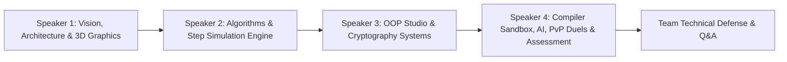

# Algoverse (Code Nova) — 4-Person Viva Presentation Script & Defense Strategy

---

## Overview & Team Role Allocation

| Member | Focus Area | Core Modules Covered | Suggested Time |
| :--- | :--- | :--- | :--- |
| **Speaker 1** | **Team Lead, Architecture & 3D Interactive Graphics** | Project Vision, System Architecture, 3D Particle Intro, 3D Library Room, Dual-Database Resilience & Security. | ~2.5 – 3 mins |
| **Speaker 2** | **Data Structures & Algorithm Animation Engine** | DS Suite (Arrays, Trees, Graphs, Heaps, Lists), Step-Generation Engine, Variable Tracker, Complexity Profiler. | ~2.5 – 3 mins |
| **Speaker 3** | **OOP Studio & Cryptography Systems** | 4 OOP Pillars, Dynamic Dispatch, 13 Ciphers (AES-256, RSA, Diffie-Hellman, SHA-256, Steganography, Enigma, Hacker Mode). | ~2.5 – 3 mins |
| **Speaker 4** | **Compiler Sandbox, AI Engine, PvP Duels & Gamification** | Monaco Cloud Runner (JDoodle), Multi-Tier AI Complexity Engine (Gemini 2.0 + AST fallback), Socket.io 1v1 Duels, Host Dashboard, Conclusion. | ~2.5 – 3 mins |

**Total Presentation Time:** 10 – 12 minutes (+ 5–10 minutes Examiner Q&A)

---

## 🎤 Detailed Script & Hand-offs

---

### 👤 Speaker 1: Introduction, Architecture & 3D Interactive Graphics

#### 1. Hook & Opening (0:00 – 0:45)
> *"Respected external examiners, faculty members, and colleagues, good morning.  
> Learning Computer Science from static textbooks and 2D pseudo-code has always been a barrier for students. When learning complex pointer manipulation, dynamic method dispatch, or multi-round block ciphers, static diagrams fail to convey temporal state transitions.  
> To solve this, our team developed **Algoverse** (also known as **Code Nova**) — a production-ready, full-stack interactive computer science laboratory combining 3D spatial environments, step-by-step memory simulators, multi-language cloud compilation, deterministic AI complexity reasoning, and real-time multiplayer coding battles."*

#### 2. Architecture & Dual-Database Resilience (0:45 – 1:45)
> *"I oversaw the core architecture and graphics pipeline. Our system is built with a high-performance modern stack:
> - On the frontend, we use [React 19](file:///d:/yusra/programming/Major_Projects/Algoverse/frontend/package.json#L28), [Vite 8](file:///d:/yusra/programming/Major_Projects/Algoverse/frontend/package.json#L45), [TailwindCSS v4](file:///d:/yusra/programming/Major_Projects/Algoverse/frontend/package.json#L32), and [Zustand](file:///d:/yusra/programming/Major_Projects/Algoverse/frontend/package.json#L34).
> - On the backend, we run an [Express 5](file:///d:/yusra/programming/Major_Projects/Algoverse/backend/package.json#L21) REST server alongside [Socket.io](file:///d:/yusra/programming/Major_Projects/Algoverse/backend/package.json#L27) for real-time WebSockets.
> - **Zero-Downtime Data Resilience**: In educational and laboratory settings, cloud database outages should never crash a student's session. In [server.js](file:///d:/yusra/programming/Major_Projects/Algoverse/backend/server.js#L44-L59), we configure a 4-second failover timeout against MongoDB Atlas. If Atlas is unreachable, the platform automatically switches to our resilient local JSON persistent engine in [storage.js](file:///d:/yusra/programming/Major_Projects/Algoverse/backend/services/storage.js), maintaining uninterrupted registration, streaks, and progress."*

#### 3. 3D Graphics & Spatial Navigation (1:45 – 2:30)
> *(Pointing to screen / Demoing [Intro.jsx](file:///d:/yusra/programming/Major_Projects/Algoverse/frontend/src/pages/Intro.jsx))*  
> *"For visual engagement, we built an 18,000-particle GLSL GPU morphing simulation using Three.js and `@react-three/fiber`. As the user scrolls, Lenis inertial smoothing drives camera trajectories across 4 morphological stages: Cosmic Nebula, Planetary Sphere, Double Helix, and Galactic Core.  
> Passing the intro leads directly into our **3D Virtual Library Room** in [Visualizer3DLibrary.jsx](file:///d:/yusra/programming/Major_Projects/Algoverse/frontend/src/visualizers/oop/components/Visualizer3DLibrary.jsx), where students inspect interactive 3D procedural bookshelves for DSA, OOP, Cryptography, and Sandbox.  
> 
> I will now hand over to **[Speaker 2 Name]**, who will explain our core Data Structures and Algorithm Simulation Engine."*

---

### 👤 Speaker 2: Data Structures & Algorithm Simulation Engine

#### 1. The Algorithm Engine Architecture (2:30 – 3:30)
> *"Thank you, [Speaker 1 Name].  
> While many websites provide pre-recorded GIF animations of sorting, Algoverse features a **dynamic deterministic step-generation engine**.  
> In our Data Structures suite ([ArrayHub.jsx](file:///d:/yusra/programming/Major_Projects/Algoverse/frontend/src/visualizers/ds/ArrayHub.jsx)), we support 8 distinct domains and over 40 algorithmic variations — including contiguous arrays, linked structures, self-balancing trees, priority queues, and weighted graphs.  
> When a user selects or inputs custom data, our generator functions (like `generateArraySteps`) execute a simulated dry-run before rendering. Each execution step captures an atomic state snapshot:
> 1. Active pointer indexes (such as $L$, $R$, and $Mid$ in Binary Search).
> 2. Comparing and swapping states.
> 3. Active execution line numbers mapped to our [CodeInspector](file:///d:/yusra/programming/Major_Projects/Algoverse/frontend/src/visualizers/ds/Array3DVisualizer.jsx#L9).
> 4. Variable watch states synchronized with [DryRunVariableTracker](file:///d:/yusra/programming/Major_Projects/Algoverse/frontend/src/visualizers/ds/Array3DVisualizer.jsx#L10)."*

#### 2. Advanced Algorithmic Demonstrations (3:30 – 5:00)
> *(Demonstrating [Array3DVisualizer.jsx](file:///d:/yusra/programming/Major_Projects/Algoverse/frontend/src/visualizers/ds/Array3DVisualizer.jsx) and [MergeSortView.jsx](file:///d:/yusra/programming/Major_Projects/Algoverse/frontend/src/visualizers/ds/array/views/MergeSortView.jsx))*  
> *"Let us highlight three key implementations:
> - **Recursive Merge Sort**: Rather than flattening the sorting process, we visually reconstruct the complete binary recursion tree, showing divide partitions splitting downward and merge buffers resolving upward in $O(N \log N)$ time.
> - **Trapping Rain Water**: We simulate elevation boundaries and render dynamic 3D blue water column heights calculated via $\min(\text{leftMax}, \text{rightMax}) - \text{height}[i]$.
> - **Graph Traversals & Pathfinding**: In [GraphVisualizer.jsx](file:///d:/yusra/programming/Major_Projects/Algoverse/frontend/src/visualizers/ds/GraphVisualizer.jsx), we visualize BFS queue operations, DFS recursion stacks, and greedy edge relaxations in Dijkstra's and $A^*$ algorithms.
> 
> Next, **[Speaker 3 Name]** will present our interactive Object-Oriented Programming and Cryptography Studios."*

---

### 👤 Speaker 3: OOP Studio & Cryptography Systems

#### 1. Object-Oriented Programming Studio (5:00 – 6:15)
> *"Thank you, [Speaker 2 Name].  
> OOP is often taught abstractly, leaving students confused about real memory layouts. In [OopOverview.jsx](file:///d:/yusra/programming/Major_Projects/Algoverse/frontend/src/visualizers/oop/OopOverview.jsx), we built interactive physical simulations for all four pillars:
> 1. **Encapsulation ([EncapsulationVisualizer.jsx](file:///d:/yusra/programming/Major_Projects/Algoverse/frontend/src/visualizers/oop/EncapsulationVisualizer.jsx))**: A Car Engine module demonstrating `private double fuelLevel`. Any external mutation triggers an unauthorized access security shield; state changes must pass through validated `accelerate()` and `refuel()` methods.
> 2. **Abstraction ([AbstractionVisualizer.jsx](file:///d:/yusra/programming/Major_Projects/Algoverse/frontend/src/visualizers/oop/AbstractionVisualizer.jsx))**: An ATM interface exposing clean public contracts while hiding ISO 8583 banking protocols and cash dispenser hardware logic.
> 3. **Inheritance**: We built dedicated labs for Single, Multilevel, and Hierarchical inheritance architectures.
> 4. **Polymorphism ([PolymorphismVisualizer.jsx](file:///d:/yusra/programming/Major_Projects/Algoverse/frontend/src/visualizers/oop/PolymorphismVisualizer.jsx))**: Demonstrates **Dynamic Virtual Method Dispatch**. An abstract reference `Person alex` is assigned `Developer`, `Parent`, `Athlete`, or `Musician` at runtime. Calling `alex.performRole()` dynamically refracts into distinct behaviors without requiring conditional `if-else` type checking."*

#### 2. Cryptography & Cyber Security Studio (6:15 – 7:30)
> *(Navigating to [CryptoHub.jsx](file:///d:/yusra/programming/Major_Projects/Algoverse/frontend/src/visualizers/crypto/CryptoHub.jsx))*  
> *"Security is critical in modern computer science. Our Cryptography Studio features 13 interactive algorithms:
> - **Modern Standards**: In [AESVisualizer.jsx](file:///d:/yusra/programming/Major_Projects/Algoverse/frontend/src/visualizers/crypto/AESVisualizer.jsx), we visualize all 14 rounds across the $4 \times 4$ byte state matrix: `SubBytes` S-Box substitution, `ShiftRows`, `MixColumns` in Galois Field $GF(2^8)$, and `AddRoundKey`.
> - **Asymmetric Crypto & Key Exchange**: In [RSAVIsualizer.jsx](file:///d:/yusra/programming/Major_Projects/Algoverse/frontend/src/visualizers/crypto/RSAVIsualizer.jsx) and [DHVisualizer.jsx](file:///d:/yusra/programming/Major_Projects/Algoverse/frontend/src/visualizers/crypto/DHVisualizer.jsx), we demonstrate prime generation, Euler's totient, modular exponentiation, and public key agreement over unencrypted channels.
> - **Hashing & Steganography**: In [SHA256Visualizer.jsx](file:///d:/yusra/programming/Major_Projects/Algoverse/frontend/src/visualizers/crypto/SHA256Visualizer.jsx), we visualize 512-bit block padding, 64-word schedule expansion, and the 64-round compression loop, illustrating the **avalanche effect**. In [SteganographyVisualizer.jsx](file:///d:/yusra/programming/Major_Projects/Algoverse/frontend/src/visualizers/crypto/SteganographyVisualizer.jsx), text is embedded directly into the Least Significant Bits (LSB) of canvas RGB pixel channels.
> - **Historical Cryptanalysis**: We simulated the electro-mechanical WWII Enigma machine with plugboard and rotors, as well as a **Hacker Mode** executing real-time **Chi-Squared ($\chi^2$) frequency attacks** against English letter distributions.
> 
> I now hand over to **[Speaker 4 Name]** to demonstrate our Code Sandbox, AI Engine, Multiplayer Duels, and Assessment Center."*

---

### 👤 Speaker 4: Compiler Sandbox, AI Engine, PvP Duels & Assessment

#### 1. Code Sandbox & Multi-Tier AI Analysis (7:30 – 8:45)
> *"Thank you, [Speaker 3 Name].  
> In our Code Sandbox ([Sandbox.jsx](file:///d:/yusra/programming/Major_Projects/Algoverse/frontend/src/pages/Sandbox.jsx)), students write code using Monaco Editor in JavaScript, Python, C++, or Java:
> - **Execution Pipeline**: Code is sent to [sandboxController.js](file:///d:/yusra/programming/Major_Projects/Algoverse/backend/controllers/sandboxController.js#L4) with a 50 KB payload guard and executed in isolated containers via JDoodle with a 15-second timeout.
> - **Multi-Tier AI Complexity Engine**: When users click 'Analyze Complexity', our backend employs an intelligent fall-through pipeline:
>   1. Primary: Calls Google Gemini 2.0 Flash or OpenRouter.
>   2. Fallback: If external APIs are unavailable or offline, our **Deterministic Static AST Analyzer** evaluates loop nesting depth ($O(1)$, $O(N)$, $O(N^2)$), detects logarithmic step counters ($O(\log N)$), identifies recursion and divide-and-conquer ($O(N \log N)$), and checks heap allocations for space complexity. Students always receive accurate Big-O analysis even completely offline."*

#### 2. Real-Time Multiplayer PvP Duels & Assessment (8:45 – 10:00)
> *(Demonstrating [DuelMode.jsx](file:///d:/yusra/programming/Major_Projects/Algoverse/frontend/src/game/DuelMode.jsx) & [GameWorld.jsx](file:///d:/yusra/programming/Major_Projects/Algoverse/frontend/src/game/GameWorld.jsx))*  
> *"To motivate students, we built gamified assessment and competition features:
> - **Real-Time 1v1 PvP Coding Duels**: Managed by [duelManager.js](file:///d:/yusra/programming/Major_Projects/Algoverse/backend/socket/duelManager.js) using Socket.io. Students join matchmaking, get paired in isolated rooms, answer randomized questions, and see their opponent's progress bar in real time. Winner determination evaluates total score, with exact millisecond duration (`timeTakenMs`) as an automated tie-breaker.
> - **Dynamic CS Trivia**: Integrated with the Open Trivia Database API in [levels.js](file:///d:/yusra/programming/Major_Projects/Algoverse/backend/routes/levels.js#L114), generating dynamic, fresh question sets on each play.
> - **Gamification & Email Notifications**: Includes 90-day GitHub-style activity heatmaps ([ActivityHeatmap.jsx](file:///d:/yusra/programming/Major_Projects/Algoverse/frontend/src/game/ActivityHeatmap.jsx)), XP tracking, and transactional badge award emails delivered via Resend/SMTP ([emailService.js](file:///d:/yusra/programming/Major_Projects/Algoverse/backend/services/emailService.js)).
> - **Teacher/Host Portal**: Instructors can host custom contests in [HostDashboard.jsx](file:///d:/yusra/programming/Major_Projects/Algoverse/frontend/src/game/HostDashboard.jsx) and auto-generate unit test cases.
> 
> In conclusion, Algoverse bridges the gap between theoretical computer science and intuitive visual comprehension.  
> We thank our mentor and examiners for their time, and our entire team is now open for your questions."*

---

## 🎯 Top Examiner Viva Q&A Strategy (Role-by-Role)

### Questions for Speaker 1 (Architecture & 3D Engine)

**Q1: Why did you use React 19 and Vite instead of Next.js or traditional React?**
> **Answer:** *"React 19 provides superior concurrent rendering and native asynchronous transitions without re-render lag. Since Algoverse is an intensive Single Page Application (SPA) with continuous WebGL rendering, Monaco editor integration, and WebSockets, Next.js server-side rendering is unnecessary for real-time visualizers. Vite gives us lightning-fast HMR and native ES module bundling, keeping client bundle sizes lean through dynamic lazy loading (`React.lazy`)."*

**Q2: How does your dual-database fallback in `storage.js` work without data inconsistency?**
> **Answer:** *"In [server.js](file:///d:/yusra/programming/Major_Projects/Algoverse/backend/server.js#L44-L56), we set `serverSelectionTimeoutMS: 4000` and `mongoose.set('bufferCommands', false)`. This prevents queries from hanging indefinitely if MongoDB Atlas is offline. When Atlas is unreachable, all user queries, activity logs, and competitions fall back immediately to synchronous, atomic JSON file writes in `.data/*.json` handled by [storage.js](file:///d:/yusra/programming/Major_Projects/Algoverse/backend/services/storage.js). When Atlas reconnects, our seed script verifies record counts and synchronizes state."*

**Q3: How do 18,000 3D particles perform smoothly without lagging low-spec client machines?**
> **Answer:** *"In [ParticleField.jsx](file:///d:/yusra/programming/Major_Projects/Algoverse/frontend/src/pages/Intro.jsx#L9), the particles are computed entirely on the GPU via custom GLSL vertex shaders rather than CPU JavaScript loops. Attribute buffers hold coordinates for all 4 geometric targets, and the vertex shader interpolates particle positions based on the scroll progress uniform. Lenis inertial smoothing filters mousewheel notch jitter to maintain 60 FPS."*

---

### Questions for Speaker 2 (Data Structures & Algorithm Engine)

**Q1: How do your visualizers step backward without recomputing the entire algorithm?**
> **Answer:** *"In [arrayStepGenerators.js](file:///d:/yusra/programming/Major_Projects/Algoverse/frontend/src/visualizers/ds/Array3DVisualizer.jsx#L15), our step generators pre-compute an immutable chronological array of step snapshots (`animationSteps[]`). Each snapshot stores an array clone, active pointer indices ($L, R, \text{mid}$), highlighted indices, and the current code line. Stepping backward or jumping to any position on the playback bar simply selects index `i - 1` with $O(1)$ random access, avoiding expensive recomputation."*

**Q2: How is the Trapping Rain Water problem solved and visualized?**
> **Answer:** *"We use the Two-Pointer approach. At any point $i$, the trapped water height is $\min(\text{leftMax}, \text{rightMax}) - \text{height}[i]$. In [RainWaterView.jsx](file:///d:/yusra/programming/Major_Projects/Algoverse/frontend/src/visualizers/ds/Array3DVisualizer.jsx#L17), our generator tracks converging $L$ and $R$ pointers, maintaining running maximums and rendering realistic translucent blue vertical bars representing the trapped water volume."*

**Q3: What makes your Merge Sort visualizer different from standard bar visualizers?**
> **Answer:** *"Standard visualizers only show the final flat array swapping. In [MergeSortView.jsx](file:///d:/yusra/programming/Major_Projects/Algoverse/frontend/src/visualizers/ds/array/views/MergeSortView.jsx), we visually build the actual binary recursion tree. We show the initial array splitting into left and right sub-arrays across hierarchy levels, followed by colored merge pointers pulling sorted elements into temporary buffers before committing back to the main array."*

---

### Questions for Speaker 3 (OOP & Cryptography Systems)

**Q1: How does your Polymorphism lab demonstrate Dynamic Dispatch under the hood?**
> **Answer:** *"In [PolymorphismVisualizer.jsx](file:///d:/yusra/programming/Major_Projects/Algoverse/frontend/src/visualizers/oop/PolymorphismVisualizer.jsx), we declare an abstract superclass `Person` with an abstract method `performRole()`. At runtime, the caller holds a single reference `Person alex`, but assigns concrete subclasses (`Developer`, `Parent`, `Athlete`, `Musician`). When `alex.performRole()` is called, our visualizer demonstrates how the language runtime's Virtual Method Table (vtable) resolves the method pointer dynamically based on the instantiated object's heap type, without requiring `if-else` type inspections."*

**Q2: What is the Avalanche Effect in SHA-256 and how do you demonstrate it?**
> **Answer:** *"The avalanche effect is a vital cryptographic property where a single bit change in plaintext alters approximately 50% of the output hash bits. In [SHA256Visualizer.jsx](file:///d:/yusra/programming/Major_Projects/Algoverse/frontend/src/visualizers/crypto/SHA256Visualizer.jsx), users flip a single character (e.g., 'cat' vs 'bat') and watch the 64-round compression loop apply bitwise rotations ($\Sigma_0, \Sigma_1$) and non-linear functions (`Ch` and `Maj`), resulting in completely divergent 256-bit hashes."*

**Q3: How does your LSB Image Steganography work without corrupting the picture?**
> **Answer:** *"Human eyes cannot distinguish 1-bit intensity variations in an 8-bit color channel (values from 0 to 255). In [SteganographyVisualizer.jsx](file:///d:/yusra/programming/Major_Projects/Algoverse/frontend/src/visualizers/crypto/SteganographyVisualizer.jsx), we convert text characters into 8-bit binary streams and replace the Least Significant Bit of each pixel's Red, Green, and Blue bytes. Changing a byte from `240` (`11110000`) to `241` (`11110001`) modifies luminance by less than 0.4%, concealing the payload seamlessly."*

---

### Questions for Speaker 4 (Sandbox, AI Engine, PvP Duels & Assessment)

**Q1: How does your static analyzer calculate Big-O complexity when AI APIs are offline?**
> **Answer:** *"In [sandboxController.js](file:///d:/yusra/programming/Major_Projects/Algoverse/backend/controllers/sandboxController.js#L86-L203), function `generateStaticAnalysis` performs pattern-based parsing on the source code. It tracks iterative loop nesting to compute $O(1)$, $O(N)$, or $O(N^2)$ polynomial time; detects step-halving operations (`/= 2`, `mid = (low + high) / 2`) to identify $O(\log N)$; checks recursive calls with sorting logic for $O(N \log N)$; and inspects dynamic collection allocations (`new Array`, `vector`, recursion depth) to calculate auxiliary Space Complexity."*

**Q2: How do you prevent race conditions and cheating in 1v1 PvP coding duels?**
> **Answer:** *"In [duelManager.js](file:///d:/yusra/programming/Major_Projects/Algoverse/backend/socket/duelManager.js), all room generation, player pairing, and question shuffling take place on the server. When players complete their questions, the client submits their final score along with `timeTakenMs` recorded from `Date.now()`. The server verifies that both players have finished before broadcasting results. If scores are tied, the server uses `timeTakenMs` as an objective tie-breaker."*

**Q3: How do you prevent malicious code execution in the sandbox (e.g., `rm -rf /` or infinite loops)?**
> **Answer:** *"We use three layers of defense:
> 1. Payload Guard: We limit request payloads to 50 KB to prevent buffer overruns.
> 2. Isolated Execution: Code is executed inside JDoodle's isolated, sandboxed Docker containers with non-root privileges and disabled raw socket access.
> 3. Execution Timeout: We enforce a strict 15-second timeout on all compiler requests. Long-running infinite loops are automatically terminated with an execution error."*

---

## 📋 Viva Presentation Checklist

- [ ] **Dual-Screen / Projector Setup**: Ensure frontend (`http://localhost:5173`) and backend (`http://localhost:5000`) are active.
- [ ] **Tab Setup**: Open tabs in advance:
  1. Intro Page (`/intro`)
  2. 3D Library Room (`/visualizer`)
  3. Array / MergeSort Visualizer (`/visualizer/array`)
  4. Polymorphism OOP Studio (`/oop/polymorphism`)
  5. Cryptography AES / Enigma Studio (`/visualizer/crypto`)
  6. Code Sandbox (`/sandbox`)
  7. 1v1 Duel Arena / Assessment Dashboard (`/game`)
- [ ] **Credentials Ready**: Have a demo account logged in so protected routes open immediately.
- [ ] **Confidence & Delivery**: Stand in order of speaking; make clear eye contact with examiners during transitions.
